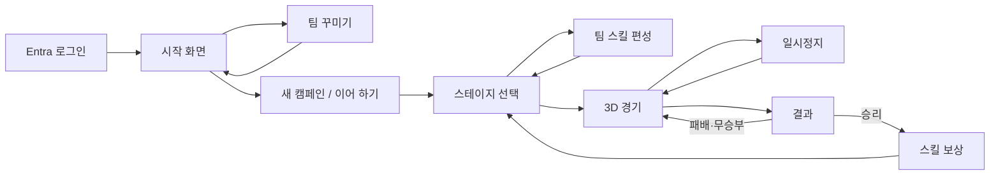

# YDJ Football 3D 현행 게임 정의서

> 기준일: 2026-10-27 · 기준: 이 저장소의 현재 로컬 코드 · 상태: BETA
> 문서 성격: **구현 현황 정의서**. 초기 기획안이나 배포 서버의 동작 보증서가 아니다.

## 1. 제품 개요

YDJ Football 3D는 PC 브라우저에서 키보드로 플레이하는 싱글 플레이 아케이드 축구 게임이다. 사용자는 골키퍼 1명과 필드 선수 3명으로 구성된 팀을 조작해 AI 팀과 4대4로 경기한다. 다섯 단계의 캠페인을 진행하면서 승리 보상으로 팀 스킬을 얻고, 장착 순서를 바꿔 다음 경기에 사용한다. 경기 장면은 WebGL2 기반 3D 경기장으로 표시된다.

| 항목 | 현행 정의 |
| --- | --- |
| 화면/플랫폼 | PC 브라우저 중심 웹앱, WebGL2가 필요한 3D 경기 화면 |
| 경기 형태 | 사용자 팀 대 AI 팀, 양 팀 각각 필드 선수 3명 + 골키퍼 1명 |
| 진행 방식 | 총 5단계 캠페인; 승리한 단계는 재도전 가능 |
| 경기 시간 | 정규 시간 60초; 동점이면 30초 골든골 연장; 끝까지 동점이면 무승부 |
| 계정/저장 | 조직 Microsoft Entra 로그인 후 프로필 API와 클라우드 저장소에 진행 정보 저장 |
| 현재 UI 표기 | `BETA`; 앱 패키지 버전은 `0.1.0` |

근거: [시작 화면](../game/src/components/StartScreen.jsx), [경기 상수](../game/src/game/constants.js), [초기 경기 상태](../game/src/game/createInitialGameState.js), [3D 캔버스](../game/src/components/Match3DCanvas.jsx), [앱 설정](../game/package.json).

## 2. 사용자 경험과 화면 흐름

| 화면 | 주요 기능 |
| --- | --- |
| 로그인 | Entra 계정 로그인, 인증·프로필 로딩 오류와 재시도 표시 |
| 시작 | 별명 설정, 새 캠페인, 이어 하기, 팀 꾸미기, 기록 보기 |
| 팀 꾸미기 | 로고와 유니폼 색상 조합 선택·저장 |
| 스테이지 선택 | 해금·클리어 상태, 상대 팀 정보, 재도전, 팀 편성 진입 |
| 팀 스킬 편성 | 보유 스킬 확인, 최대 3개 장착, 장착 순서 변경 |
| 3D 경기 | 카메라가 경기를 따라가는 경기장, 점수·시간·미니맵·스태미나·스킬 상태·소리 버튼 |
| 결과 | 승·패·무승부와 점수, 재도전 또는 승리 보상 진입 |
| 스킬 보상 | 새 스킬 획득 또는 보유 스킬 레벨업 선택 |
| 기록 | 현재 프로필의 최고 기록 표시 |

근거: [App 화면 전환](../game/src/App.jsx), [스테이지 선택](../game/src/components/StageSelectScreen.jsx), [경기 UI](../game/src/components/GameScreen.jsx).

## 3. 경기 규칙과 조작

### 3.1 조작

경기장에 키보드 포커스가 있을 때 다음 입력을 받는다. 화면을 클릭하면 경기장에 다시 포커스가 간다.

| 입력 | 공격 또는 공 소유 시 | 수비 또는 공을 뺏긴 경우 |
| --- | --- | --- |
| 방향키 | 선수 이동·킥 방향 조정 | 선수 이동 |
| `E` | 스프린트; 스태미나를 소비하고 미사용 시 회복 | 스프린트; 스태미나 동일 적용 |
| `A` | 로빙 패스 | 슬라이딩 태클 시도 |
| `S` | 땅볼 패스 | 조작 선수 전환 |
| `D` | 일반 슛 | 상대 공 소유자를 향한 압박 이동 |
| `F` | 장착한 팀 스킬 발동 | 장착한 팀 스킬 발동 |

공중볼의 헤딩·걷어내기는 조건에 따라 자동 처리된다. 공을 가진 상대와 수비수가 가까워지면 기본 태클도 자동 시도한다. 일반 슛은 골대까지의 거리에 따라 공의 높이와 궤적이 바뀌며 별도의 슛 게이지는 없다.

근거: [입력 처리](../game/src/game/createInputController.js), [경기 시뮬레이션](../game/src/game/stepGame.js), [경기 안내 문구](../game/src/components/GameScreen.jsx).

### 3.2 시간·득점·재개

- 최초 킥오프에서 공을 차면 경기 시간이 시작된다. 골 뒤에는 실점한 팀의 킥오프로 재개한다.
- 정규 시간 종료 시 동점이면 30초 골든골 연장전에 들어간다. 연장전에서 골이 나면 즉시 승부가 결정되고, 30초가 끝나도 동점이면 무승부다.
- 공이 밖으로 나간 위치와 마지막 터치 팀에 따라 스로인, 코너킥 또는 골킥으로 재개한다. 사용자 팀의 재개 상황에서는 방향키로 방향을 고른다.
- 골킥은 골키퍼의 준비·킥 동작과 받을 동료의 위치 이동을 보여준다. 사용자 팀 골킥은 `A` 장거리 킥 또는 `S` 짧은 패스이며, 준비 중 입력을 미리 받을 수 있다.
- 경기장 좌표는 960×540이고 골대의 유효 가로 범위는 `y=180…360`이다. 실제 3D 렌더의 화면상 크기는 카메라에 따라 달라진다.

근거: [경기 상수](../game/src/game/constants.js), [경기 시뮬레이션](../game/src/game/stepGame.js), [경기 UI](../game/src/components/GameScreen.jsx).

## 4. 캠페인과 스킬

캠페인은 1단계에서 시작한다. 시작 시 팀 스킬 4종 중 하나를 무작위로 받아 장착한다. 승리하면 다음 단계가 열리고 스킬 보상을 선택할 수 있다. 패배·무승부는 현재 단계에서 재도전하며 보유 스킬과 캠페인 진행 기록은 유지된다. 이미 클리어한 단계도 다시 선택할 수 있다.

| 스킬 | 역할 | 게임 내 설명 | 최고 레벨 |
| --- | --- | --- | --- |
| 독수리슛 | 공격 | 일반 골키퍼가 막을 수 없는 필살 슛 | 3 |
| 회오리슛 | 공격 | 수비수를 휘어 지나가는 슛 | 3 |
| 을룡타 | 수비 | 앞의 상대를 최대 3명까지 5초간 기절시킴 | 3 |
| 진공청소기 | 유틸리티 | 주변 공을 사용자에게 끌어옴 | 1 |

보유 스킬 중 최대 3개를 순서대로 장착한다. `F`는 사용 가능한 스킬을 장착 순서에 따라 선택한다. 스킬별 재사용 대기시간은 10초, 같은 팀 전체 스킬의 공통 대기시간은 3초다. 상대 팀이 갖는 스킬 수는 1~5단계에서 각각 `0/1/2/3/3`종이며, 최초 킥오프와 골 뒤 재개 직후 3초 동안 상대 AI 스킬 사용을 제한한다.

근거: [캠페인](../game/src/game/campaign.js), [스킬 목록·발동](../game/src/game/skills.js), [상수](../game/src/game/constants.js), [편성 화면](../game/src/components/LoadoutScreen.jsx).

## 5. 화면·연출·소리

- **3D 표현:** React Three Fiber/Three.js로 경기장, 선수, 공, 관중석 및 스킬 효과를 렌더링한다. 카메라는 경기를 따라가며, 점수판과 미니맵은 화면 UI로 표시한다.
- **스킬 연출:** 발동 시 컷인과 스킬별 3D 효과를 보여준다. 골 뒤에는 관중의 움직임과 점수 알림이 나타난다.
- **배경 음악:** 로그인 후부터 로그아웃할 때까지 브라우저에서 생성한 아케이드풍 반복 음악을 재생한다. 상용 대회 공식 음원은 포함되지 않는다.
- **관중 소리:** 경기 중 낮은 관중 웅성거림을 반복하고 킥오프·골 때 함성을 더한다. 일시정지하면 웅성거림을 멈춘다.
- **소리 설정:** 경기 화면 오른쪽 위 스피커 버튼으로 소리를 켜고 끈다. 설정은 현재 접속 중에만 유지한다.

브라우저의 자동 재생 정책이나 오디오 장치 상태에 따라 소리가 사용자 입력 이후 시작될 수 있다.

근거: [3D 캔버스](../game/src/components/Match3DCanvas.jsx), [경기 UI](../game/src/components/GameScreen.jsx), [음악](../game/src/game/menuMusic.js), [관중 소리](../game/src/game/matchAudio.js), [앱 오디오 상태](../game/src/App.jsx).

## 6. 데이터와 시스템 경계

| 구성요소 | 책임 |
| --- | --- |
| React 앱 | 화면 전환, 캠페인 상태, 경기 UI, 사용자 입력 |
| 순수 경기 로직 | 4대4 상태, AI, 공·슛·태클·스킬·득점·재개·경기 시간 계산 |
| 3D 렌더러 | 현재 경기 상태를 경기장·선수·공·효과로 표시; WebGL2 필요 |
| Entra 인증 | 지정된 조직 계정 로그인과 프로필 API용 액세스 토큰 획득 |
| `/api/profile` | 인증된 사용자 프로필 조회·저장 |
| Cosmos DB | 사용자별 프로필 영속 저장; 브라우저에는 계정별 캐시 유지 |

프로필의 주요 필드는 `nickname`, `teamCustomization`, `campaignSave`, `bestRecord`다. 캠페인 저장에는 현재 단계, 클리어 결과, 보유·장착 스킬, 보상 대기 상태, 상대 스킬 구성이 포함된다. **진행 중인 경기의 공 위치·남은 시간은 저장 필드가 아니다.** 일시정지 상태에서는 같은 화면 안의 경기 상태를 유지하지만, `저장하고 메인 화면으로`를 선택하면 캠페인 진행 정보만 저장한다.

근거: [프로필 모델](../game/src/storage/localProfile.js), [프로필 동기화](../game/src/storage/profileRepository.js), [프로필 API](../game/api/src/functions/profile.js), [Cosmos 저장](../game/api/src/storage/profileCosmos.js), [App 저장 흐름](../game/src/App.jsx).

## 7. 현행 구현의 확인 사항

1. **배포본과의 동일성:** 이 문서는 로컬 작업 트리의 코드를 기준으로 작성했다. 배포된 앱이 정확히 같은 리비전인지는 별도 배포 확인이 필요하다.
2. **경기 이어 하기 문구:** 일시정지 화면은 `현재 경기 상태와 남은 시간은 그대로 보관됩니다`라고 안내하지만, 메인으로 나갔다가 다시 시작하는 경우 경기 중 상태까지 복원하는 저장 로직은 확인되지 않는다. 문구 또는 기능을 맞출 필요가 있다.
3. **최종 단계 결과 표기:** 5단계 승리 후 캠페인 상태는 `complete`가 되지만, 결과 화면에 전달하는 `outcome`은 `win`으로 남는다. 스테이지 선택 화면에는 우승 배너가 있으나 결과 화면의 `캠페인 우승!` 분기는 현재 흐름에서 사용되지 않는다.
4. **실기기 검증 범위:** WebGL2 지원, 로그인 권한, 클라우드 API, 소리 자동 재생은 실행 환경의 영향을 받는다. 이 문서는 코드 검토를 바탕으로 하며 브라우저별 실사용 품질 검증 결과는 포함하지 않는다.
5. **현재 자동 테스트:** 2026-10-27 로컬 작업 트리에서 `npm run build`는 통과했다. `npm test`는 179개 중 176개 통과, 3개 실패다. 실패 항목은 최초 킥오프의 홈 스킬 발동, 을룡타 후 조작 선수·점유권 처리, 넘어짐 회복 후 동작 상태이며 모두 `stepGame.test.js`에 있다. 따라서 해당 동작은 완료된 품질 보증으로 표시하지 않는다.

## 8. 핵심 참조 파일

| 목적 | 파일 |
| --- | --- |
| 화면·캠페인 연결 | [App.jsx](../game/src/App.jsx) |
| 경기 상태 모델 | [createInitialGameState.js](../game/src/game/createInitialGameState.js) |
| 경기 규칙·입력 반영 | [stepGame.js](../game/src/game/stepGame.js) |
| 스킬·보상 | [skills.js](../game/src/game/skills.js), [campaign.js](../game/src/game/campaign.js) |
| 3D 표현·카메라 | [Match3DCanvas.jsx](../game/src/components/Match3DCanvas.jsx), [TrackingCamera3D.jsx](../game/src/components/TrackingCamera3D.jsx) |
| 경기 HUD | [GameScreen.jsx](../game/src/components/GameScreen.jsx) |
| 인증·저장 | [entraAuth.js](../game/src/auth/entraAuth.js), [profileRepository.js](../game/src/storage/profileRepository.js) |
